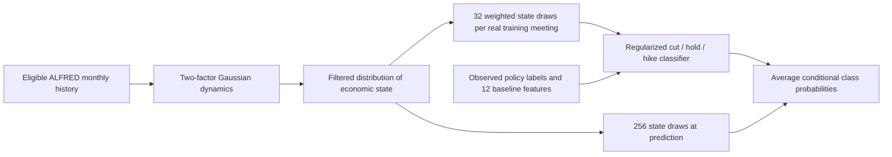

# World-model pilot: computed results

The first small world model **does not improve Fed-decision probabilities over
the existing models**. Weighted synthetic latent states score 0.5096 Brier,
ordinary logistic regression 0.5077, and the existing shallow trees 0.4248.
This tests one restrained architecture, not the general value of economic
simulation, structural priors, or world models.

Run: [`7185f66f7271`](world_model_runs/7185f66f7271/complete.json).
Specification: [`configs/world_model.yaml`](../configs/world_model.yaml).
Research and assumptions: [pilot design](../docs/world_model_pilot.md).
All historical comparisons are **exploratory**: these test years were already
examined in earlier experiments. Model choices were frozen before this pilot's
test evaluation; none were changed in response to these scores.

## Architecture and synthetic-data accounting



The five channels are headline/core CPI monthly changes, payroll growth,
unemployment and industrial-production growth. PCA loadings and ridge monthly
transitions define a two-stage Gaussian factor model; a Kalman filter handles
partially observed months. This is an approximate statistical world model, with
no identified causal factors or Bayesian parameter uncertainty.

The archive has **335 monthly reference periods**, 1,675 series-months and
14,214 vintage records. Those versions are not separate independent observations.
At each fit, only eligible historical values enter the economic model. The
test-period fits contain 294–331 complete months; later inputs update the
filtered state without entering that forecast's parameter fitting.

The augmented classifier uses the existing 12 features plus two latent states.
Each of a real meeting's 32 plausible latent states receives its observed label
and weight 1/32. Its total influence stays one meeting. At prediction, average
256 conditional probability vectors. The first saved training example contains
5,792 synthetic views of 181 real meetings, not 5,792 independent Fed decisions.
The code also saves three-month synthetic macro paths, with no invented release
timestamps or policy outcomes; those paths are not used as labeled training rows.

## Real sample and model selection

All 207 scheduled meetings from February 2000 through December 2025 remain in
the panel: 27 cuts, 40 hikes and 140 holds. The chronological split is unchanged:

| Split | Decisions | Meetings | Cuts / holds / hikes |
|---|---|---:|---:|
| Initial training | February 2000–May 2019 | 155 | 18 / 108 / 29 |
| Development | June 2019–September 2022 | 26 | 3 / 18 / 5 |
| Test | November 2022–December 2025 | 26 | 6 / 14 / 6 |

Four chronological development folds select classifier C from .01, .1, 1 and 10
for each of five new variants: 20 candidates and 80 fits. All select C=.01.
Selection retains the existing cut-component Brier weight 2. State dimension,
transition regularization, measurement floor and sampling budgets were fixed in
advance for this pilot; they were not searched. Fits and preprocessing use only
their training data. Test forecasts retrain on expanding history, including a
previous test label only after it becomes available.

The original frequency, logistic and tree predictions are copied unchanged from
[`extended_2000-b4a00efeac35`](runs/extended_2000-b4a00efeac35/complete.json).
No class weighting or oversampling changes class frequencies. The missed-cut
cost rule is a separate hard-decision calculation, with unchanged probabilities.

## Fed forecasting results

Scores use the same 26 real test decisions. Brier is
`mean_i sum_k (p[i,k] - 1[y[i]=k])^2`, unnormalized, with range 0–2.
Log loss is the mean negative natural log of the probability of the realized
class, with the inherited numerical clipping at 1e-15. Both favor lower values.
Accuracy uses the largest-probability class; always-hold accuracy is 14/26=53.85%.

| Model | Brier | Log loss | Accuracy |
|---|---:|---:|---:|
| Historical frequency | 0.636944 | 1.066945 | 53.85% |
| Existing logistic | 0.507742 | 0.864115 | 65.38% |
| Existing shallow trees | **0.424813** | **0.735772** | **73.08%** |
| Logistic + 12 months of macro history | 0.538485 | 0.908515 | 61.54% |
| Generic noise augmentation control | 0.507792 | 0.864217 | 65.38% |
| World-model latent means | 0.512392 | 0.870177 | 65.38% |
| Latent means in training; integrate states at prediction | 0.514026 | 0.872949 | 65.38% |
| Synthetic latent-state training + integration | 0.509614 | 0.866698 | 65.38% |

The augmented-minus-logistic Brier difference is **+0.001873**, with descriptive
95% paired moving-block interval **[-0.003225, +0.008109]**. Against trees it is
**+0.084802**, interval **[+0.028237, +0.137661]**. Eight-meeting blocks account
for local dependence, but 26 observations, few policy cycles, multiple comparisons
and repeated historical experimentation limit inference. Synthetic rows do not
enter the uncertainty calculation.

Augmentation slightly improves the same world model relative to using latent
means or integrating only at prediction. Those paired intervals cross zero,
and neither comparison establishes an advantage over ordinary logistic or trees.

Cut performance also fails to improve: the augmented model identifies **0/6 cuts
by argmax**, or **1/6 with the existing missed-cut cost of 2**, with no false cut
calls. Those are the same counts as ordinary logistic. Trees identify 3/6 by
argmax or 4/6 with the cost rule, with one false cut call under either rule.

Saved artifacts include [per-meeting probabilities](world_model_runs/7185f66f7271/predictions.parquet),
[probability plot](world_model_runs/7185f66f7271/probabilities.png),
[calibration plot](world_model_runs/7185f66f7271/calibration.png),
[calibration counts and intervals](world_model_runs/7185f66f7271/calibration.csv),
[class-specific scores](world_model_runs/7185f66f7271/by_class.csv), and
[largest errors](world_model_runs/7185f66f7271/largest_errors.csv).

## Does it forecast economic releases better?

A separate diagnostic predicts each channel's next unreported reference month.
It compares the Gaussian world-model distribution with persistence of the last
value, using training-estimated innovation variance. Targets use their first
permitted available vintage. The target need not arrive before the Fed meeting.

| Channel | Scored targets | Persistence CRPS | World CRPS | World 90% interval coverage |
|---|---:|---:|---:|---:|
| Headline CPI monthly change, percentage points | 25 | 0.137680 | 0.111938 | 100% |
| Core CPI monthly change, percentage points | 25 | 0.067582 | 0.053832 | 96% |
| Payroll monthly change, thousands | 26 | 406.123978 | 291.356970 | 100% |
| Unemployment, percent | 25 | 0.158477 | 0.660372 | 100% |
| Industrial-production monthly change, percentage points | 26 | 0.444154 | 0.291053 | 100% |

CRPS rewards concentrated distributions near the outcome; lower is better.
Units differ across rows, so do not average the raw scores across channels.
There are 127 scored forecasts per model and three missing derived targets;
related series and potentially repeated target periods are not independent.
See [release scores](world_model_runs/7185f66f7271/release_comparison.csv)
for standardized CRPS and Gaussian log scores.

The world model improves on this simple persistence comparator in four channels,
but unemployment is substantially worse. The high interval coverage also shows
that distributions are often broad; 100% coverage does not demonstrate good
calibration. This is evidence that the macro and Fed tasks can behave differently,
not validation of a superior economic simulator.

An ex-post availability audit finds no new inflation/employment reference period
in 134 of 207 seven-day windows under the conservative availability rule. It
does not reconstruct historical release calendars. Simulating releases inside
the seven-day window is therefore an incomplete mechanism for this task; better
state estimates or economic priors could still matter on other meetings.

## Verification and remaining limits

- **57 tests pass**, including future-revision poisoning, publication-versus-period
  dates, training-only transformations, synthetic parent weights, probability
  validity and macro-target separation. Ruff passes.
- The [independent artifact verifier](world_model_runs/7185f66f7271/verification.json)
  recomputes policy scores, checks unchanged baselines, eligible state inputs,
  chronological CV and label cutoffs, synthetic provenance and release intervals.
- The original run `00ab4eb11917` is retained. A numeric aggregation bug affected
  only its auxiliary 90% interval-coverage summary. The corrected run above also
  adds synthetic-parent lineage and fixes plot-title spacing; its policy/CV
  prediction tables are exactly identical to the first run. These were
  correctness/rendering replays, not retuning.
- Original data limits remain: conservative next-business-day availability for
  releases with unknown intraday time, one stale IP feature cell, 128 unknown
  decision publication times, retrospective calendars and few independent cut
  cycles. Monthly history and revisions are never counted as new Fed labels.
- Gaussian tails, estimated rather than integrated parameter uncertainty, the
  simple two-stage estimator and absent historical release calendar limit the
  simulator. No structural synthetic policy labels or PSI training were implemented.

## Next experiment suggested by the research

The next distinct hypothesis is **economic structure as a prior**. The
[Del Negro–Schorfheide DSGE-VAR work](https://fraser.stlouisfed.org/files/docs/historical/frbatl/wp/frbatl_wp_2002-14a.pdf)
provides a macroeconomic precedent for expressing model restrictions through
artificial-observation priors. A small simulator could vary plausible persistence,
shocks, policy inertia and reaction coefficients, then contribute limited-weight
synthetic training examples. Their policy labels would come from explicit
assumptions. They would not be historical evidence about how the Fed behaved.

First compare a compact ordered reaction model with economic priors against
ordinary shrinkage. Then test a small structural simulator, with its total
synthetic influence selected on development data, including **zero**, plus
incorrect/shuffled-structure controls. Freeze the protocol and use future real
decisions for confirmation. Merely increasing the number of sampled rows from
this fitted Gaussian model is not supported by the present result.

## Reproduce

From the repository root, with the extended panel and its baseline run present:

```sh
export UV_CACHE_DIR="$PWD/.cache/uv"
export MPLCONFIGDIR="$PWD/.cache/matplotlib"
export LOKY_MAX_CPU_COUNT=1
uv run --frozen python scripts/run_world_model.py
uv run --frozen python scripts/verify_world_model.py reports/world_model_runs/7185f66f7271
uv run --frozen pytest -q
uv run --frozen ruff check src scripts tests
```

This pilot uses local cached data and adds no dependencies. Completed identical
runs are reused. To reconstruct prerequisite data, follow the
[extended-history commands](../docs/extended_2000.md). Original reports and runs
remain intact; generated artifacts stay outside version control.
